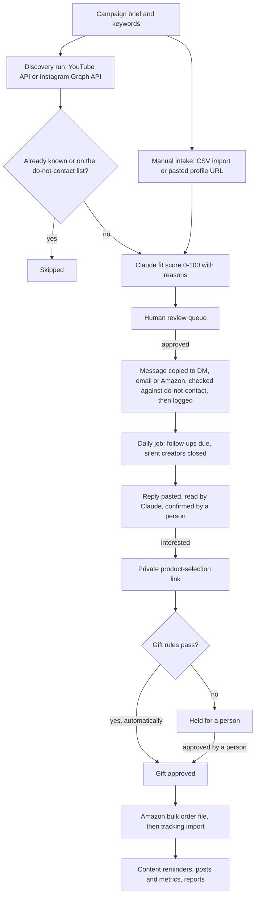

# Creator Growth Engine

An internal creator-gifting CRM. It finds US creators through the YouTube Data API, scores how
well each one fits a campaign with Claude, and runs the gift-for-content pipeline from the first
DM to the posted content. The AI never approves anyone: a person decides on every creator and
presses send on every message. Only gift orders that pass the written rules and timer-based
status changes happen automatically.

About 25.7k lines of TypeScript · 24 data models · 31 automated guard tests plus an end-to-end
security test · built by [Khushi Jaiswal](#my-role)

## The problem it solves

A D2C textile e-commerce company sells home textiles to US customers under two brands. Its
marketing team ran influencer gifting from spreadsheets: they found creators by hand, messaged
them one by one, noted each address and placed the Amazon gift orders by hand, and kept the
whole record in Excel. This app gives each creator one audited record and automates the
discovery, scoring, follow-up timing, in-rule gift approval and reporting, while people still
press send on every message.

## Key features

- **One-click creator discovery.** An admin starts a YouTube Data API run from a campaign's
  keywords; results are checked against known creators and a do-not-contact list, inside the
  daily quota. An Instagram hashtag adapter is built and tested against recorded Graph API
  responses, but has not run live: it needs a Meta app approved for public content access.
- **AI scores, people decide.** Claude gives a 0-100 fit score with reasons, but it is only a
  recommendation: a person approves or rejects each creator in a review queue.
- **Outreach on timers.** Templates are copied into the right channel (Instagram DM, email or
  Amazon Creator Connections) and logged. Follow-ups come due by themselves on each campaign's
  timers.
- **Reads replies with AI.** Claude sorts a pasted reply into 8 classes and pulls out its warmth,
  questions and any fee. A person confirms the class.
- **Creators choose their own gift.** A private, expiring link lets a creator pick a product and
  enter an address. Orders that pass the gift rules in a JSON config are approved automatically.
- **Replaces manual Amazon work.** It imports the Seller Central listing report, exports approved
  gifts as a Multi-Channel Fulfillment bulk order file, and imports tracking in bulk.
- **Tracks content and results.** Content reminders come due from the delivery date (a person
  sends them). It logs posts and their numbers, shows performance reports and emails a summary
  every Monday.

## Tech stack

- **App:** TypeScript, Next.js 15 (App Router, Server Components, Server Actions), React 19
- **Data:** PostgreSQL on Neon, Prisma 6
- **AI:** Anthropic Claude API (`@anthropic-ai/sdk`), JSON-schema output, Zod, prompt caching
- **Integrations:** YouTube Data API v3, Meta Instagram Graph API, Nodemailer (SMTP), Amazon files
- **Auth and UI:** Auth.js v5 with bcrypt, Tailwind CSS v4, shadcn/ui, installable PWA
- **Hosting and testing:** Netlify with scheduled functions, Node test runner, PGlite, pnpm

## How it works

Pages are React Server Components that re-check the signed-in user and their brand on every
request, and all writes go through Server Actions that check them again. Long AI and discovery
jobs run as short, lock-protected slices that a scheduled function continues in the background.
The app never messages a creator itself: it copies the text, opens the destination and logs it.

## Engineering highlights

- **The AI only recommends.** Scoring can move a creator from `discovered` to `scored` and no
  further. A test uses a fake model that answers "approved" while a person approves someone
  mid-run, and checks that nothing overrides the person.
- **Model output is checked twice.** A JSON schema shapes the answer, Zod validates it again and
  a bad answer is retried once. A refused profile is left unscored while the run goes on, and a
  rejected key or a rate limit stops the run cleanly.
- **Prompt-injection and privacy defences.** Emails are removed before profiles reach the model,
  and the prompt treats scraped profile text as information, never instructions.
- **AI measured against people.** Prompts are versioned per brand. Admins mark agree or disagree
  on sampled scores, and the reply reader's guess is stored beside the person's choice.
- **Cost recorded.** Scoring uses prompt caching on the shared campaign block and a low
  reasoning-effort setting, and each run records its tokens and an estimated USD cost (an upper
  bound: cached tokens are priced at the full input rate).
- **Graceful fallbacks.** If the API fails, the reply reader falls back to a tested rules-based
  reader. Without API keys, scoring, discovery and email show "not configured" instead of
  failing.
- **Tests.** 31 guard tests run on an in-memory Postgres (PGlite) with local stubs for the Meta,
  YouTube and Anthropic APIs. They cover quotas, gift rules, encryption, rate limits and brand
  scoping. An end-to-end test starts the production build and tries to reach the other brand's
  data by URL and forged Server Action calls, and every attempt must fail.
- **Security.** One brand-scope helper filters every page and Server Action query, and an unknown
  brand matches nothing. Sign-in uses bcrypt with lockout after 5 failed tries. Shipping
  addresses are encrypted with AES-256-GCM. Selection links use 192-bit single-use tokens. HSTS
  and other security headers are set, and CSV exports are protected against formula injection.
- **Automation.** Netlify scheduled functions run the daily timers, a 10-minute job tick and a
  weekly email. Jobs are resumable slices with database lease locks. Automatic changes are
  idempotent (tested) and logged under a separate system account.

## Screenshots and demo

This is an internal, login-protected tool holding real creator data, so there is no public demo.

<!--
TODO: add a demo video link and screenshots, both recorded on seed data.

Screenshots: uncomment the four image lines once the PNGs exist in docs/screenshots/.
Take them from a local copy running the seed data (sample creators with `.sample` handles).
Never capture the production portal or real creator data. The sidebar and the brand switch
show the real brand names on every page (src/components/app-shell.tsx): crop them out or
accept that they show.

To take: home.png (Home task list and tiles), pipeline-board.png (a sample campaign's board),
review-queue.png (AI scores and reasons; run scoring on the sample campaign with your own key),
reply-reader.png (Log a reply with the AI's reading of a made-up reply). Optional: the gift
order drawer with its rules, the public selection page, Reports > Performance and
Admin > Scoring calibration.
-->

## Status

**Built:** everything under Key features, plus CSV and URL intake, a bookmarklet and Android share
target, a creator card, a rule-based in-app guide, admin screens, server-side scripts and both
test suites.

**Not built:** sending messages from the app (a person always presses send), automatic inbox or
DM reading, TikTok discovery, Amazon APIs (data moves by file; sales are typed in), carrier
tracking feeds, the paid data-vendor adapter (stub), contracts and feedback (tables unused), a
library of creators' content files, Shopify sync, ROI attribution, SSO or self-service password
reset.

<!--
TODO: add a Results line once real numbers exist (from Reports in the app), e.g.
**Results:** Creators processed: N · Messages logged: N · Gifts shipped: N · Hours saved vs the spreadsheet: N.
-->

## Getting started

Requirements: Node 20 or newer (Netlify builds on Node 22), pnpm, and a Neon database (use a
separate branch for local work, never production).

1. `pnpm install`, then copy `.env.example` to `.env` and fill it in (table below).
2. Open `prisma/seed.ts` and set the admin's name and email in `USERS`. Add teammates later under
   Admin > Users. The name is what `{sender}` becomes in message templates.
3. `pnpm db:migrate`, then `pnpm db:seed`. The seed creates the admin, 10 message templates, 2
   sample campaigns and 10 sample creators (`.sample` handles). It is safe to run again: existing
   rows are left alone and existing users keep their password.
4. `pnpm dev`, open http://localhost:3000 and sign in with the admin's email and
   `SEED_USER_PASSWORD`.

| Variable | Required | Purpose |
| --- | --- | --- |
| `DATABASE_URL` | yes | Neon pooled connection string (host contains `-pooler`). End it with `&connect_timeout=15&pool_timeout=20` so a sleeping database can wake. |
| `DIRECT_URL` | yes | Neon direct connection string, used by `prisma migrate`. End it with `&connect_timeout=15`. |
| `AUTH_SECRET` | yes | Signs the session cookie. `.env.example` has a command that makes one. |
| `AUTH_TRUST_HOST` | on Netlify / `pnpm start` | `true` (already set in `.env.example`). |
| `AUTH_URL`, `APP_URL` | in production | The public address (same value): sign-in redirects, creators' selection links, scheduled functions. Leave empty locally. |
| `CRON_SECRET` | in production | Secret the scheduled functions send to `/api/cron/*`. |
| `ADDRESS_ENCRYPTION_KEY` | in production | 32 random bytes in base64. Encrypts shipping details; without it new addresses are stored unencrypted. Keep a copy. |
| `SEED_USER_PASSWORD` | for seeding | Password given to the seed admin. At least 10 characters. |
| `CREATOR_SOURCE` | no | Default creator adapter: `manual` (default), `csv`, `youtube`, `meta_free` or `vendor` (stub). |
| `APP_TIME_ZONE` | no | IANA zone for timestamps and report periods. Default `UTC`. |
| `LEGAL_CONTACT_EMAIL` | recommended | Address shown on `/privacy` and `/terms`. |
| `SMTP_URL`, `SUMMARY_EMAIL_FROM`, `SUMMARY_EMAIL_TO` | for the weekly email | SMTP connection and addresses for the Monday summary. |
| `YOUTUBE_API_KEY`, `YOUTUBE_DAILY_QUOTA` | for YouTube discovery | API key, and its daily units (default 10,000; discovery stops at 80%). |
| `META_ACCESS_TOKEN`, `IG_BUSINESS_ID` | for Instagram discovery | Long-lived Graph API user token and your Instagram business account id. |
| `META_GRAPH_VERSION` | no | Pin a Graph API version, e.g. `v23.0`. |
| `ANTHROPIC_API_KEY` | for AI features | Anthropic API key for scoring and the reply reader. |
| `ANTHROPIC_MODEL`, `ANTHROPIC_READER_MODEL` | no | Scoring model (default `claude-opus-5-5`) and reply-reader model (default `claude-sonnet-5-5`). |

A missing key never crashes anything: the feature reports "not configured" and the Admin page
shows which services are configured. Keys are read only in server code; never give them a
`NEXT_PUBLIC_` prefix.

| Command | What it does |
| --- | --- |
| `pnpm dev` / `pnpm build` / `pnpm start` | Dev server on port 3000 / `prisma generate` plus a production build / serve the build. |
| `pnpm lint` / `pnpm typecheck` | ESLint / TypeScript without emitting. |
| `pnpm db:migrate` / `pnpm db:migrate:dev` | Apply migrations (`prisma migrate deploy`, use on Neon) / create a migration after a schema change. |
| `pnpm db:seed` / `pnpm db:studio` / `pnpm db:backup` | Seed / Prisma Studio / write every table to `data/backups/` (git-ignored). |
| `pnpm test` / `pnpm build && pnpm test:isolation` | The 31 guard tests / the end-to-end brand-isolation test. |

## More documentation

[docs/OPERATIONS.md](docs/OPERATIONS.md) covers deploying to Netlify, backups, server-side
scripts, security details, what each test checks, the creator adapters, brand access rules, the
automated journey, CSV and Amazon imports, each build phase and known warnings.

## My role

Built by Khushi Jaiswal as an IT trainee, for her employer's marketing team, with AI-assisted
development (Claude Code).
<!-- TODO: one line on what you personally owned, e.g. requirements with the marketing team,
design decisions, testing and rollout. -->
Commits were made from the company's GitHub account. The code belongs to the employer and is published with its
permission; no open-source license is granted.
